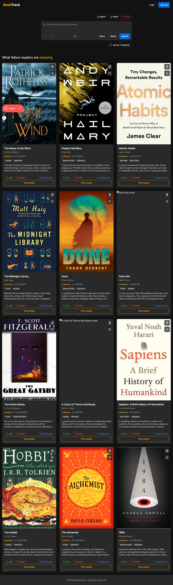
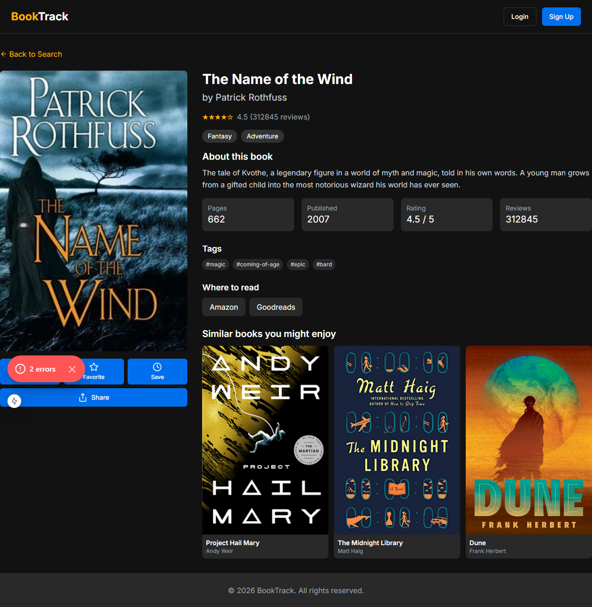
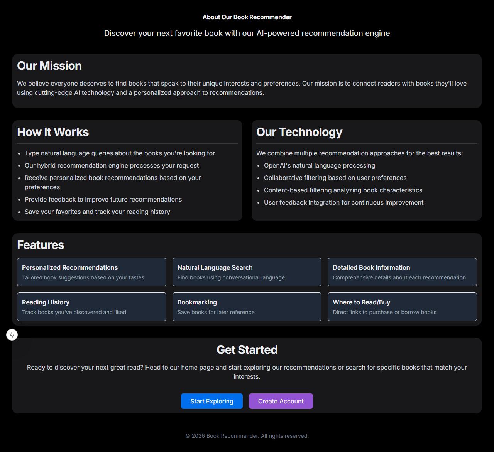
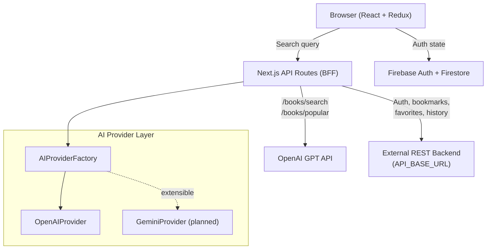

# BookTrack

**AI-powered book discovery — search by mood, genre, title, or "something like Dune."**

---

## Overview

BookTrack is a full-stack book recommendation web app that turns natural language queries into curated reading lists. Users can search conversationally ("dark thrillers with an unreliable narrator"), filter by genre and rating, bookmark favorites, track search history, and export their reading activity — all wrapped in a dark, responsive UI.

The recommendation engine routes queries to OpenAI's GPT API via server-side Next.js API routes, keeping keys off the client and making the AI provider swappable through an abstract factory pattern.

---

## Preview

**Home page with search and filters**



**Book detail page**



**About page**



---

## Highlights

- **Conversational search** — query by title, author, genre, mood, or "similar to..." with real-time filter + sort controls
- **OpenAI integration with provider abstraction** — an `AIProvider` abstract class + factory lets the AI backend switch from GPT to Gemini without touching consuming code
- **BFF architecture** — Next.js API routes act as a Backend-for-Frontend, proxying to an external service and calling OpenAI server-side so no keys reach the client
- **Multi-layer collections** — authenticated users can bookmark, favorite, and save-for-later independently, all persisted in Firestore
- **Exportable search history** — full history with keyboard replay (↑/↓ to cycle), export to JSON/CSV/TXT, and Web Share API integration
- **CSRF protection + Firebase Emulator support** — `X-CSRF-TOKEN` headers on mutation routes; local dev works without a real Firebase project

---

## Use Cases

| Use Case | User | Outcome |
|---|---|---|
| "Show me cozy mysteries under 300 pages" | Casual reader | AI returns genre+length-filtered recs |
| Research a reading list by mood/theme | Book club organizer | Natural language query returns exportable results |
| Track and revisit past searches | Avid reader | Search history with one-click replay |
| Save books discovered over multiple sessions | Any authenticated user | Bookmarks/favorites synced via Firestore |

---

## Features

### Search & Discovery
- Natural language search (any / title / author / genre / mood / similar-to query types)
- Filter by genre (20+ options) and minimum star rating
- Sort by popularity, rating, newest, oldest
- Debounced input (500 ms) with keyboard history navigation

### Book Details
- Cover image, rating, genre tags, page count, publication year
- Series position, user-defined tags
- Where to read/buy links (Amazon, Goodreads, Google Books, Worldcat, LibraryThing)
- Genre-based similar book suggestions

### Collections (authenticated)
- Bookmark, favorite, and save-for-later — independently toggled
- Inline feedback per book (Like / Dislike / Regenerate)

### Search History
- Last 10 searches stored in Redux; individual or bulk removal
- One-click replay with previous query pre-filled
- Export to JSON, CSV, or plain text; share via Web Share API

### Auth & Account
- Email/password and Google OAuth via Firebase Auth
- User profile, preferences, and reading lists persisted in Firestore

---

## Tech Stack

| Layer | Technology | Purpose |
|---|---|---|
| Framework | Next.js 15 (App Router) | SSR, API routes, routing |
| Language | TypeScript | Type safety across the full stack |
| State | Redux Toolkit | Cross-component state (books, auth, bookmarks) |
| AI | OpenAI GPT-3.5-turbo | Natural language book search & recommendations |
| Auth & DB | Firebase (Auth + Firestore + Storage) | User accounts, data persistence |
| UI Components | HeroUI v2, shadcn/ui | Accessible, themeable component library |
| Primitives | Radix UI | Headless dialog, popover, dropdown, select |
| Styling | Tailwind CSS | Utility-first, custom booktrack-gold/dark palette |
| Animation | Framer Motion | Page transitions and micro-interactions |
| Toasts | Sonner | Non-blocking feedback notifications |
| Validation | Zod | Runtime type safety at API boundaries |
| Icons | Lucide React | Consistent icon set |

---

## Architecture



**Request lifecycle (search):**
1. User types in the `SearchBar` → Redux `searchBooks` thunk dispatched
2. Mock data filters for instant client-side results (dev); real calls hit `/api/books/search`
3. API route constructs a GPT prompt via `AIProviderFactory.getProvider("openai")`
4. OpenAI returns JSON; `parseBookRecommendations()` normalizes variable response shapes
5. Books land in Redux `booksSlice.results` and render via `BookList → BookCard`

---

## How It Works

1. **Type a query** — supports plain text or prefixed queries (`genre: dystopian`, `mood: cozy`, `similar: Project Hail Mary`)
2. **Filters applied** — genre and rating dropdowns narrow results; sort dropdown reorders the grid
3. **AI generates recs** — server-side GPT call returns structured JSON; the `AIProvider` base class handles parsing across multiple response shapes (`books[]`, `recommendations[]`, etc.)
4. **Browse results** — book cards show cover, author, rating stars, genre chips, and a description excerpt
5. **Save & organize** — authenticated users can bookmark, favorite, or save for later with one click
6. **History & export** — all searches are saved locally; navigate back with arrow buttons or export the full list

---

## Setup

### Prerequisites
- Node.js 18+
- OpenAI API key
- Firebase project (or use the emulator for local dev)

### Install

```bash
git clone <repo-url>
cd book-recommender
npm install
```

### Environment Variables

Copy `.env.sample` to `.env.local` and fill in your values:

```bash
cp .env.sample .env.local
```

```env
# Firebase (client)
NEXT_PUBLIC_FIREBASE_API_KEY=
NEXT_PUBLIC_FIREBASE_AUTH_DOMAIN=
NEXT_PUBLIC_FIREBASE_PROJECT_ID=
NEXT_PUBLIC_FIREBASE_STORAGE_BUCKET=
NEXT_PUBLIC_FIREBASE_MESSAGING_SENDER_ID=
NEXT_PUBLIC_FIREBASE_APP_ID=
NEXT_PUBLIC_FIREBASE_MEASUREMENT_ID=

# Firebase (server-side admin)
FIREBASE_PROJECT_ID=
FIREBASE_PRIVATE_KEY=
FIREBASE_CLIENT_EMAIL=

# OpenAI
OPENAI_API_KEY=

# Optional: use local Firebase emulators
NEXT_PUBLIC_USE_FIREBASE_EMULATORS=false
```

### Run Locally

```bash
npm run dev       # http://localhost:3000
```

### Lint & Format

```bash
npm run lint      # ESLint (auto-fix)
npm run format    # Prettier
```

### Build for Production

```bash
npm run build
npm run start
```

### Firebase Emulators (optional)

Set `NEXT_PUBLIC_USE_FIREBASE_EMULATORS=true` in `.env.local`, then start the emulators with:

```bash
firebase emulators:start
```

Auth → `:9099` | Firestore → `:8080` | Functions → `:5001` | Storage → `:9199`

---

## Usage

**Natural language search:**
```
"psychological thriller with unreliable narrator"
"similar: The Name of the Wind"
"genre: sci-fi mood: hopeful"
```

**Keyboard shortcuts in the search bar:**
- `Enter` — submit search
- `Shift+Enter` — newline in query
- `↑ / ↓` arrow buttons — cycle through past searches

**Search history export:**
- Click **Export** → choose JSON / CSV / TXT → downloads immediately

---

## Key Decisions

| Decision | Rationale | Tradeoff |
|---|---|---|
| Abstract `AIProvider` + factory | Swap OpenAI for Gemini without touching search routes | Adds an indirection layer for a single current provider |
| Redux Toolkit over React Query | Bookmarks/favorites shared across deeply nested components without prop drilling | More boilerplate; better for global cross-component state |
| Next.js API routes as BFF | OpenAI key never reaches the browser; centralizes auth, rate-limiting, and error handling | Additional hop vs. calling OpenAI from the client |
| GPT JSON mode (`response_format: json_object`) | Eliminates prompt-engineering fragility for structured output | Requires gpt-3.5-turbo-1106 or later; slightly higher cost |
| Firebase Emulator support | Fully functional local dev without a live Firebase project | Extra setup step; emulator state doesn't persist by default |
| CSRF token via cookie + header | Protects mutation endpoints against cross-site request forgery in a stateless SPA pattern | Client must attach the header explicitly on all POST/PUT/DELETE calls |

---

## Innovation / Notable Work

- **Flexible JSON normalization** — `parseBookRecommendations()` handles four different GPT response shapes (`[]`, `{ books: [] }`, `{ recommendations: [] }`, `{ data: [] }`) and gracefully falls back on parse failure, making the AI integration resilient to prompt variation
- **Provider factory with extensibility** — The `AIProviderFactory` + abstract `AIProvider` design means adding Gemini support is a single new class, with zero changes to the API routes or UI
- **Hybrid recommendation pipeline** — the about page documents the planned integration of OpenAI NLP + collaborative filtering + content-based filtering + user feedback, reflecting deliberate product thinking about improving rec quality over time
- **Export + Web Share API** — search history is exportable (JSON/CSV/TXT) and shareable via native share sheet on mobile, a feature depth rarely seen in portfolio projects

---

## Potential Metrics to Track

| Metric | Why It Matters |
|---|---|
| Search → bookmark conversion rate | Signals recommendation quality |
| GPT response latency (p50 / p95) | User experience in the critical search path |
| Search history replay rate | Shows how often users find past queries useful |
| Feedback ratio (Like/Dislike/Regenerate) | Drives future personalization loop |

---

## Roadmap

- **Gemini provider** — wire up the `GeminiProvider` stub in `AIProviderFactory`
- **Reading goal tracking** — `UserPreferences.readingGoal` is modeled but not surfaced in the UI
- **Collaborative filtering** — use accumulated Like/Dislike feedback to weight recommendations toward the user's demonstrated preferences
- **Pagination** — `SearchState.currentPage` and `totalPages` are modeled; connect them to the UI for large result sets
- **PWA** — `public/manifest.json` is already present; add a service worker for offline support

---

## About

BookTrack is a collaborative project built to explore the intersection of AI-generated content and structured data — specifically, how to make LLM output reliable enough to power a real product UI. The team focused on the provider abstraction and JSON normalization layer as the engineering core, paired with a dark, book-store-aesthetic UI to make the technical work tangible and presentable.
